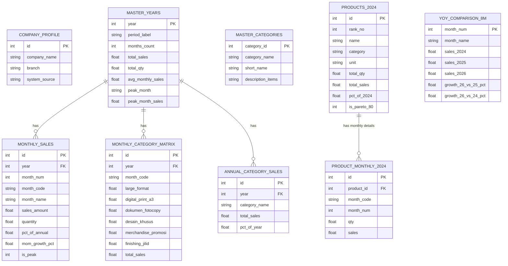

# DOKUMENTASI DATABASE SQL — SNAPRINT DIGITAL PRINTING
## Sistem Basis Data Penjualan Terintegrasi Multi-Tahun (2024, 2025, 2026)

Database ini memuat seluruh data penjualan resmi **Snaprint Digital Printing** yang dikonsolidasikan dari **ACCURATE Accounting System** untuk Tahun Buku **2024**, **2025**, dan **2026 (s/d Agustus)**.

---

### 1. Berkas Database yang Tersedia

| Nama Berkas | Tipe / Format | Keterangan |
| :--- | :--- | :--- |
| [**`snaprint_sales.db`**](file:///c:/Users/Swanto/OneDrive/Desktop/SNAPRINT_GW2024/snaprint_sales.db) | **SQLite Database File (Binary)** | Berkas database relasional mandiri (*serverless, zero-configuration*), langsung dapat dibuka dengan DBeaver, DB Browser for SQLite, TablePlus, atau script Python/NodeJS. |
| [**`snaprint_sales.sql`**](file:///c:/Users/Swanto/OneDrive/Desktop/SNAPRINT_GW2024/snaprint_sales.sql) | **SQL Script Dump (Text)** | Berkas skrip SQL standar berisi seluruh `CREATE TABLE`, `INSERT INTO`, dan `CREATE VIEW` yang dapat di-import langsung ke MySQL, MariaDB, PostgreSQL, atau SQLite. |
| [**`query_db.py`**](file:///c:/Users/Swanto/OneDrive/Desktop/SNAPRINT_GW2024/query_db.py) | **Python Query Tool (CLI)** | Alat bantu cepat untuk menjalankan query SQL langsung dari command prompt / terminal. |

---

### 2. Struktur Tabel Relasional (Schema Overview)



---

### 3. Daftar Tabel & View SQL

1. **`company_profile`**: Informasi profil Snaprint Digital Printing dan sistem pembukuan.
2. **`master_years`**: Ringkasan performa finansial per tahun buku (2024, 2025, 2026).
3. **`master_categories`**: Master 6 lini kategori bisnis dan klasifikasi item produknya.
4. **`monthly_sales`**: Rincian penjualan bulanan untuk seluruh tahun buku (total 32 baris data bulan).
5. **`monthly_category_matrix`**: Matriks penerimaan bulanan per 6 kategori produk (2025 dan 2026).
6. **`annual_category_sales`**: Rekapitulasi kontribusi kategori per tahun.
7. **`products_2024`**: Data lengkap 129 produk individual tahun 2024 beserta klasifikasi Pareto 80/20.
8. **`product_monthly_2024`**: Riwayat transaksi 12 bulan untuk masing-masing dari 129 produk tahun 2024 (1.548 baris data).
9. **`yoy_comparison_8m`**: Tabel komparasi apel-ke-apel 8 bulan pertama (Jan–Agu) lintas tahun 2024, 2025, dan 2026.

#### SQL Views (Query Cepat):
* **`v_annual_performance`**: Menampilkan ringkasan tahun, omzet terformat Rupiah, volume, dan bulan puncak.
* **`v_comparison_3_years_8m`**: Menampilkan komparasi omzet bulanan 2024 vs 2025 vs 2026 beserta persentase pertumbuhan.
* **`v_category_summary`**: Menampilkan kontribusi omzet per kategori per tahun.
* **`v_pareto_core80_2024`**: Menampilkan 24 produk inti yang menghasilkan 80% omzet tahun 2024.

---

### 4. Contoh Perintah SQL Populer

#### A. Melihat Performa Seluruh Tahun Buku
```sql
SELECT * FROM v_annual_performance;
```

#### B. Melihat Komparasi Bulanan 2024 vs 2025 vs 2026 (Jan–Agu)
```sql
SELECT * FROM v_comparison_3_years_8m;
```

#### C. Top 10 Produk Terlaris Tahun 2024
```sql
SELECT rank_no, name, category, unit, total_sales, pct_of_2024
FROM products_2024
ORDER BY rank_no ASC
LIMIT 10;
```

#### D. Total Penjualan Large Format Tahun 2026 (s/d Agustus)
```sql
SELECT SUM(large_format) AS Total_Large_Format_2026
FROM monthly_category_matrix
WHERE year = 2026;
```

---

### 5. Cara Menjalankan Query via Terminal / CMD

Gunakan skrip Python yang telah disediakan:
```powershell
# Menampilkan ringkasan tahunan & komparasi
python query_db.py

# Menjalankan query SQL bebas langsung dari terminal
python query_db.py "SELECT * FROM v_pareto_core80_2024 LIMIT 5;"
```
