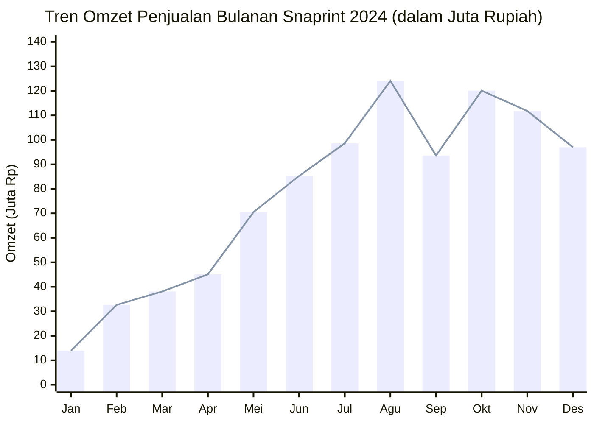
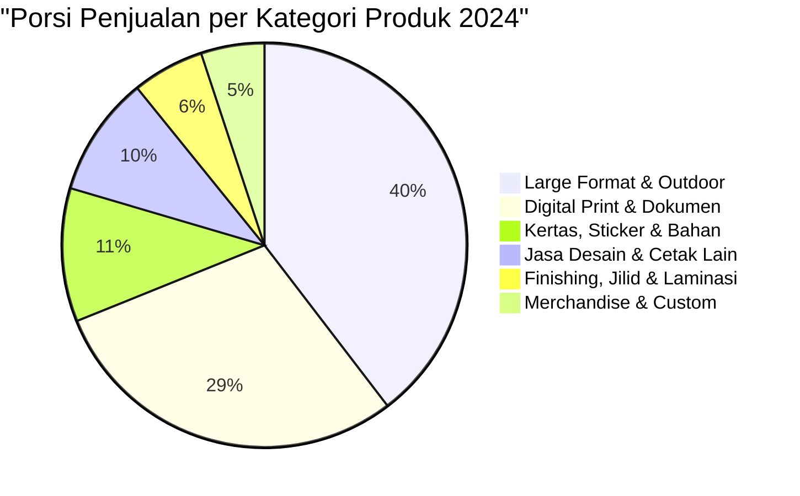

# LAPORAN KINERJA PENJUALAN TAHUNAN (ANNUAL SALES REPORT)
## SNAPRINT DIGITAL PRINTING — TAHUN BUKU 2024
**Periode:** 01 Januari 2024 s/d 31 Desember 2024  
**Sumber Data:** Sistem Pembukuan ACCURATE Accounting System (Konsolidasi 12 Bulan)  
**Dokumen Terkait:** [Laporan_Penjualan_Tahunan_2024_Snaprint_Digital.pdf](file:///c:/Users/Swanto/OneDrive/Desktop/SNAPRINT_GW2024/Laporan_Penjualan_Tahunan_2024_Snaprint_Digital.pdf)

---

## 1. RINGKASAN EKSEKUTIF (EXECUTIVE SUMMARY)

Sepanjang tahun buku 2024, **Snaprint Digital Printing** mencatatkan kinerja finansial dan volume operasional yang sangat solid dengan pertumbuhan akseleratif yang konsisten, khususnya pada paruh kedua tahun (*Semester 2*).

### Indikator Kinerja Utama (Key Performance Indicators)
| Metrik Finansial / Operasional | Capaian Tahun 2024 | Keterangan & Catatan Analis |
| :--- | :--- | :--- |
| **Total Omzet Penjualan** | **Rp 930.847.260,01** | Total akumulasi penerimaan kotor 12 bulan buku |
| **Total Volume Transaksi Terjual** | **275.498,79 unit** | Gabungan satuan lembar, meter lari, dan pcs |
| **Rata-Rata Penjualan Bulanan** | **Rp 77.570.605,00 / bln** | Rata-rata perolehan omzet per bulan berjalan |
| **Bulan Penjualan Tertinggi (Peak Month)** | **Agustus 2024 (Rp 124,07 Juta)** | Disusul Oktober 2024 (Rp 120,12 Juta) |
| **Pertumbuhan Semester (H2 vs H1)** | **+125,94%** | Lonjakan signifikan paruh kedua tahun (Rp 645,26 Jt vs Rp 285,59 Jt) |
| **Konsentrasi Pareto (Aturan 80/20)** | **23 dari 129 Produk (17,8%)** | 17,8% varian produk menggerakkan 80% total omzet bisnis |

> [!NOTE]
> Terjadi akselerasi bisnis yang sangat agresif mulai pertengahan tahun. Kuartal 1 merupakan fase pondasi awal, diikuti Kuartal 2 yang naik lebih dari 2 kali lipat, dan mencapai puncak stabilitas tinggi pada Kuartal 3 dan Kuartal 4 dengan rata-rata penjualan di atas **Rp 100 Juta per bulan**.

---

## 2. ANALISIS TREN PENJUALAN BULANAN & PERIODIK

### 2.1. Tabel Rekapitulasi Penjualan Bulanan 2024
Berikut adalah rincian data historis penjualan Snaprint Digital Printing per bulan dari Januari hingga Desember 2024:

| No | Bulan Buku | Volume / Kuantitas | Total Omzet Penjualan (Rp) | Kontribusi (%) | Tren / Milestone Bisnis |
| :-: | :--- | :---: | :---: | :---: | :--- |
| 1 | Januari 2024 | 5.222,75 | Rp 13.929.250,00 | 1,50% | Fase *low season* pasca tahun baru & setup awal |
| 2 | Februari 2024 | 13.202,81 | Rp 32.611.500,00 | 3,50% | Kenaikan awal pesanan cetak & dokumen kantor |
| 3 | Maret 2024 | 11.247,10 | Rp 38.127.300,00 | 4,10% | Pertumbuhan stabil jelang periode Ramadhan |
| 4 | April 2024 | 18.540,78 | Rp 45.112.500,00 | 4,85% | Peningkatan pesanan kemasan & merchandise |
| 5 | Mei 2024 | 30.053,96 | Rp 70.539.626,00 | 7,58% | Titik awal lompatan volume (*growth breakout*) |
| 6 | Juni 2024 | 31.163,37 | Rp 85.269.050,01 | 9,16% | Musim kelulusan sekolah & kenaikan kelas |
| 7 | Juli 2024 | 24.368,02 | Rp 98.607.639,98 | 10,59% | Awal tahun ajaran baru & kampanye promosi UKM |
| 8 | Agustus 2024 | 34.358,19 | Rp 124.067.870,00 | 13,33% | **Puncak Tertinggi 2024** (Event HUT RI & Banner) |
| 9 | September 2024 | 21.772,50 | Rp 93.620.700,00 | 10,06% | Normalisasi pasca Agustusan tetap di level tinggi |
| 10 | Oktober 2024 | 25.923,41 | Rp 120.116.770,02 | 12,90% | Puncak kedua (Aktivitas B2B & event akhir tahun) |
| 11 | November 2024 | 26.911,17 | Rp 111.824.774,00 | 12,01% | Pesanan kalender, materi Pilkada/event daerah |
| 12 | Desember 2024 | 32.734,73 | Rp 97.020.280,00 | 10,42% | Penutupan tahun buku, kalender, agenda & cetak |
| **—** | **TOTAL TAHUNAN** | **275.498,79** | **Rp 930.847.260,01** | **100,00%** | **Rata-rata: Rp 77.570.605,00 / bulan** |

### 2.2. Analisis Performa Kuartalan (Quarterly Performance)
1. **Kuartal 1 (Januari – Maret 2024):**
   * Total Omzet: **Rp 84.668.050,00** (Kontribusi: **9,10%**)
   * Rata-rata: Rp 28,22 Juta/bulan.
   * Merupakan fase konsolidasi dan adaptasi operasional awal tahun.
2. **Kuartal 2 (April – Juni 2024):**
   * Total Omzet: **Rp 200.921.176,01** (Kontribusi: **21,58%**)
   * Kenaikan: **+137,30%** dibandingkan Q1.
   * Didorong oleh lonjakan pesanan di bulan Mei dan Juni berkat momentum tahun ajaran dan persiapan acara pertengahan tahun.
3. **Kuartal 3 (Juli – September 2024):**
   * Total Omzet: **Rp 316.296.209,98** (Kontribusi: **33,98%**)
   * Kenaikan: **+57,42%** dibandingkan Q2.
   * Kuartal dengan kinerja luar biasa, menorehkan rekor bulanan tertinggi di bulan Agustus (Rp 124,07 Juta).
4. **Kuartal 4 (Oktober – Desember 2024):**
   * Total Omzet: **Rp 328.961.824,02** (Kontribusi: **35,34%**)
   * Kenaikan: **+4,00%** dibandingkan Q3.
   * Menjadi kuartal dengan omzet terbesar secara agregat, ditopang oleh pengadaan cetak akhir tahun, materi promosi korporat, dan kalender.

---

## 3. ANALISIS STRUKTUR & KOMPOSISI KATEGORI PRODUK

Portofolio 129 produk Snaprint Digital terbagi ke dalam 6 kelompok lini bisnis utama:

| No | Kategori Produk / Layanan | Jml Item | Volume Kuantitas | Total Penjualan (Rp) | Kontribusi (%) | Karakteristik Finansial & Pasar |
| :-: | :--- | :-: | :-: | :---: | :-: | :--- |
| 1 | **Large Format & Outdoor Banner** | 16 | 10.448,89 m | Rp 368.591.071,00 | **39,60%** | *Primary Cash Cow* (Nilai tiket per order besar) |
| 2 | **Digital Print & Fotocopy Dokumen** | 20 | 113.801,00 lbr | Rp 272.564.626,64 | **29,28%** | *Volume Driver* (Frekuensi tinggi & cashflow harian) |
| 3 | **Kertas, Sticker Sheet & Bahan Cetak** | 19 | 114.399,00 lbr | Rp 99.334.471,21 | **10,67%** | Margin sehat, kebutuhan branding UMKM & label |
| 4 | **Jasa Desain, Percetakan Lain & Perlengkapan** | 27 | 13.059,00 unit | Rp 89.589.831,76 | **9,62%** | *Value-Added Services* (Jasa desain, nota, offset) |
| 5 | **Finishing, Jilid & Laminasi** | 29 | 20.914,90 unit | Rp 53.541.515,72 | **5,75%** | Jasa komplementer penyempurna produk cetak |
| 6 | **Merchandise & Produk Custom** | 18 | 2.876,00 pcs | Rp 47.225.743,68 | **5,07%** | Produk kreatif (Kaos, mug, tumbler, stempel, pin) |
| **—** | **TOTAL KESELURUHAN** | **129** | **275.498,79** | **Rp 930.847.260,01** | **100,00%** |  |

### Analisis Mendalam Per Kategori:
1. **Large Format & Outdoor Banner (39,60% | Rp 368,59 Jt):**
   * Merupakan tulang punggung utama (*backbone*) revenue Snaprint.
   * Didominasi oleh lini **Flexy 280** (lebar 320, 110, dan 220) serta **Flexy 440 High Resolution**.
   * Menjadi pilihan utama untuk spanduk toko, baliho event, backdrop instansi, dan promosi luar ruang.
2. **Digital Print & Fotocopy Dokumen (29,28% | Rp 272,56 Jt):**
   * Motor perputaran arus kas harian (*working capital generator*) dengan volume mencapai 113.801 unit.
   * Dipimpin oleh produk cetak **Print Color A3** dan **Print Color A3 Bolak-Balik (Bb)** yang menghasilkan lebih dari Rp 184 Juta.
3. **Kertas, Sticker Sheet & Bahan Cetak (10,67% | Rp 99,33 Jt):**
   * Pasar label kemasan UMKM (makanan, minuman, kosmetik) sangat masif melalui media **Quantac Glossy/Doff**, **Chromo**, dan **Sticker Ritrama**.

---

## 4. ANALISIS PRODUK UNGGULAN & HUKUM PARETO (80/20)

### 4.1. Temuan Analisis Pareto
Dari total 129 varian produk dan layanan yang terdata di sistem ACCURATE:
* **Top 10 Produk** menyumbang **Rp 521.658.705,73 (56,04%)** dari total omzet.
* **Top 20 Produk** menyumbang **Rp 704.846.462,09 (75,72%)** dari total omzet.
* **80% Omzet Bisnis** dihasilkan hanya oleh **23 produk (17,8%)**.
* Sebaliknya, **106 produk lainnya (82,2%)** menyumbang 20% sisa omzet (*long-tail products*).

### 4.2. Daftar 15 Produk Penyumbang Omzet Tertinggi (Top 15 Champions)
| Peringkat | Nama Barang / Produk Layanan | Satuan | Kuantitas | Total Penjualan (Rp) | Kontribusi (%) | Porsi Kumulatif |
| :-: | :--- | :-: | :---: | :---: | :---: | :---: |
| **1** | **Print Color A3** | lembar | 29.059,00 | Rp 116.251.925,12 | 12,49% | 12,49% |
| **2** | **Flexy 280 (320)** | METER | 1.464,01 | Rp 73.704.557,37 | 7,92% | 20,41% |
| **3** | **Print Color A3 Bb** | - | 11.758,00 | Rp 68.175.847,94 | 7,32% | 27,73% |
| **4** | **Flexy 280 (110)** | METER | 3.449,67 | Rp 57.434.090,92 | 6,17% | 33,90% |
| **5** | **Flexy 280 (220)** | METER | 1.617,89 | Rp 54.312.729,54 | 5,83% | 39,73% |
| **6** | **Cetak Lain - Lain** | - | 2.295,00 | Rp 43.436.700,00 | 4,67% | 44,40% |
| **7** | **Flexy 440 (110)** | METER | 1.116,44 | Rp 32.304.273,75 | 3,47% | 47,87% |
| **8** | **QUANTAC GLOSY (32.5 X 48 cm)** | lembar | 4.864,00 | Rp 28.949.142,14 | 3,11% | 50,98% |
| **9** | **Flexy 440 (220)** | METER | 401,89 | Rp 23.560.566,26 | 2,53% | 53,51% |
| **10** | **Flexy 440 (320)** | METER | 265,95 | Rp 23.528.872,69 | 2,53% | **56,04%** |
| 11 | Sticker Ritrama Glossy (125) | METER | 370,67 | Rp 22.450.941,82 | 2,41% | 58,45% |
| 12 | Print Color A4 | - | 12.120,00 | Rp 21.818.178,79 | 2,34% | 60,79% |
| 13 | CROMO (32.5 X 48 cm) | - | 7.817,00 | Rp 20.955.069,80 | 2,25% | 63,04% |
| 14 | Cutting A3 | - | 7.644,00 | Rp 19.971.301,36 | 2,15% | 65,19% |
| 15 | AC 260 (32.5 X 48 cm) | lembar | 13.794,00 | Rp 19.059.269,00 | 2,05% | 67,24% |

---

## 5. EVALUASI OPERASIONAL & EFISIENSI SUMBER DAYA

1. **Efisiensi Mesin & Perputaran Media Cetak:**
   * **Mesin Digital Press A3+:** Bekerja dengan utilisasi sangat tinggi (menghasilkan lebih dari 55.000 klik cetak A3/A4 dan lembaran sticker). Waktu henti mesin (*downtime*) dan ketersediaan toner harus dijaga ketat.
   * **Mesin Cetak Banner Outdoor:** Konsumsi bahan Flexy 280 dan 440 mencapai lebih dari 8.300 meter lari. Stabilitas printhead dan tinta solven/eco-solvent menjadi penentu profitabilitas.
2. **Ketergantungan Finishing:**
   * Layanan seperti **Cutting A3 (Rp 19,97 Jt)**, **Laminating Tipis Roll Glossy/Doff (Rp 8,53 Jt)**, dan **Jilid Kawat/Lakban** memiliki margin kotor tinggi karena didominasi komponen jasa. Peningkatan integrasi bundling cetak + potong + laminasi terbukti meningkatkan *Average Order Value* (AOV).

---

## 6. REKOMENDASI STRATEGIS UNTUK PERTUMBUHAN 2025/2026

Berdasarkan temuan data penjualan di atas, berikut adalah 5 pilar strategi rekomendasi bagi manajemen Snaprint:

> [!TIP]
> ### 1. Amankan Kontrak Pengadaan Bahan Baku Inti (Top Tier Procurement)
> Karena 23 produk menghasilkan 80% omzet, manajemen harus melakukan negosiasi harga volume (*volume rebate*) dengan distributor utama untuk:
> * Roll Flexy 280 & Flexy 440 (semua lebar).
> * Kertas Art Carton 260, HVS, dan Sticker Quantac/Chromo A3+.
> * Penghematan 3–5% pada rantai pasok bahan baku ini berpotensi meningkatkan laba bersih tahunan secara signifikan.

> [!IMPORTANT]
> ### 2. Strategi Penetrasi Akun Korporat & B2B (Contractual Retainer)
> Pertumbuhan omzet di Semester 2 yang melonjak +125% menunjukkan bahwa permintaan pasar institusi/perusahaan/event sangat masif.
> * Konversikan pelanggan musiman event/kantor menjadi kontrak langganan (*monthly retainer*) agar kuartal 1 tidak mengalami penurunan tajam.
> * Berikan fasilitas *Terms of Payment* (TOP) terkontrol untuk instansi kredibel.

> [!TIP]
> ### 3. Standarisasi Bundling & Paket Produk Label Kemasan UMKM
> Gabungan *Print Color A3* + *Sticker Quantac/Chromo* + *Cutting A3* merupakan salah satu *workflow* paling diminati.
> * Buat paket terpadu: "Paket Stiker Label UMKM Hemat Siap Tempel" (Cetak + Laminasi + Kiss Cut).
> * Mengurangi kerumitan transaksi di kasir dan meningkatkan kecepatan layanan di counter.

> [!NOTE]
> ### 4. Manajemen Kapasitas & Jadwal Preventive Maintenance
> * Bulan Juli hingga November adalah periode beban kerja terberat (*peak load*).
> * Pastikan overhaul mesin, kalibrasi warna, dan pembersihan sistem sirkulasi tinta dilakukan pada periode tenang di bulan Februari–Maret, sehingga saat memasuki puncak permintaan (Mei–Desember), operasional mesin beroperasi dengan efisiensi 100% tanpa risiko kegagalan cetak.

> [!TIP]
> ### 5. Rasionalisasi Produk Long-Tail
> Terdapat lebih dari 50 varian barang dengan kontribusi omzet di bawah 0,05% (misalnya jenis ring kawat ukuran langka atau aksesoris minor). 
> * Lakukan seleksi inventaris agar modal kerja tidak mengendap (*dead stock*).
> * Terapkan sistem *Made to Order* atau *Just-in-Time* untuk item-item yang perputarannya lambat.

---

## 7. DOKUMEN & AKSES FILE

Dokumen laporan ini didukung oleh file resmi yang siap diunduh dan dicetak:
1. **Laporan Format PDF Siap Cetak (3 Halaman A4 Bersih & Berwarna):**  
   👉 [Laporan_Penjualan_Tahunan_2024_Snaprint_Digital.pdf](file:///c:/Users/Swanto/OneDrive/Desktop/SNAPRINT_GW2024/Laporan_Penjualan_Tahunan_2024_Snaprint_Digital.pdf)
2. **Salinan File PDF di Folder Downloads:**  
   👉 [Salinan Downloads](file:///C:/Users/Swanto/Downloads/Laporan_Penjualan_Tahunan_2024_Snaprint_Digital.pdf)
3. **Skrip Otomasi Pengolahan Data & Pembuat PDF (Python):**  
   👉 [generate_laporan_2024.py](file:///c:/Users/Swanto/OneDrive/Desktop/SNAPRINT_GW2024/generate_laporan_2024.py)

---
*Laporan disusun dan diverifikasi secara otomatis berdasarkan ekstraksi 12 bulan buku sistem ACCURATE Snaprint Digital Printing.*
